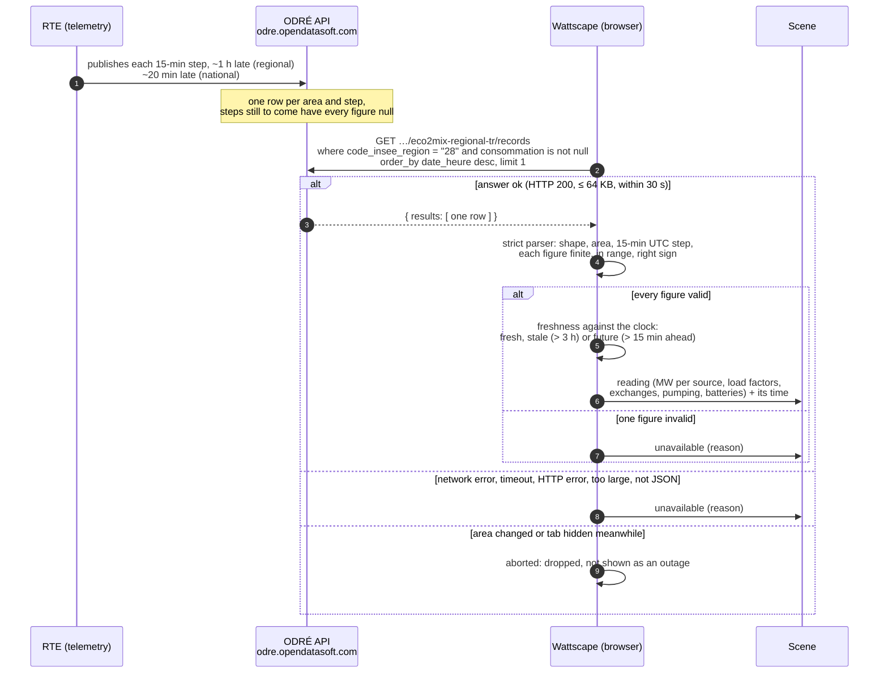
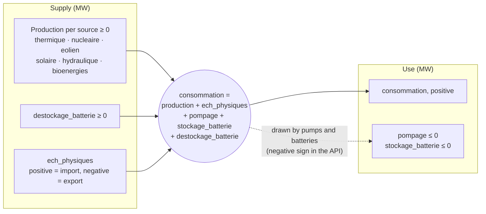

# Architecture

How Wattscape is built. What it does and why is in [`PRD.md`](PRD.md); how we work is
in [`../AGENTS.md`](../AGENTS.md). Statements marked **provisional** are design
choices not yet proven by code or measurement; **unverified** marks facts about an
external system that we have not yet checked against the system itself.

## Stack

- **TypeScript** (strict) compiled and bundled by **Vite**; tests with **Vitest**,
  browser tests with **Playwright**; **ESLint** + **Prettier**. Same versions and
  configuration as Return of the Runners, to share habits.
  - TypeScript is held below 6.1: typescript-eslint 8.x supports TypeScript < 6.1.
    Dependabot ignores newer TypeScript until typescript-eslint supports it.
  - `@types/node` stays on the major version of the Node we run (22, `.nvmrc`).
- **No runtime dependency.** The scene is drawn by our own code into an RGBA pixel
  buffer (see § Rendering), so it renders identically in Node (tests) and in the
  browser.
- **Static site** on GitHub Pages. The browser talks to two keyless public APIs
  (§ Data sources) and nothing else.

## Module layout

Provisional; each folder lands with the backlog item that needs it.

| Path          | Role                                                                                       | Touches the DOM, clock or network? |
| ------------- | ------------------------------------------------------------------------------------------ | ---------------------------------- |
| `src/main.ts` | Boot: wires the clock, data, camera, renderer and UI                                       | yes                                |
| `src/clock/`  | The only reader of wall-clock time; time-lapse and fixed time (`?at=`) for demos and tests | clock                              |
| `src/geo/`    | Regions, offline position → area lookup, map projection                                    | no                                 |
| `src/data/`   | éCO2mix and Open-Meteo clients: URL building, strict parsers, refresh and staleness        | network (fetchers only)            |
| `src/sky/`    | Sun and moon position, moon phase, light keyframes                                         | no                                 |
| `src/map/`    | The baked map of France (land, sea, regions, relief, plant sites) and its grid             | no                                 |
| `src/scene/`  | The scene model (what a frame shows) and the camera (zoom, pan, flights, drift)            | no                                 |
| `src/world/`  | Seeded PRNG; placement of plants, towns, trees and landmarks                               | no                                 |
| `src/render/` | Themes (how a scene looks), palette, dithering, sprites drawn in code, `Surface`           | no (the canvas blit is in `ui/`)   |
| `src/i18n/`   | FR and EN catalogs (`fr.json`, `en.json`), language detection                              | no                                 |
| `src/ui/`     | Canvas blit and scaling, input (zoom, pan, keys), legend, captions, settings               | DOM                                |
| `tools/`      | Scripts run by hand: fixture recording, map baking, mockups, screenshots                   | files                              |
| `tests/`      | Unit tests, recorded API fixtures, frame-hash snapshots                                    | —                                  |

Everything outside `clock/`, `data/` fetchers and `ui/` is pure: same inputs, same
output. That is what makes frames reproducible (§ World generation).

## Data sources

Which sources we use, and under which licence, is decided in the register
[`SOURCES.md` § 1](SOURCES.md#1-data-register) (GO / NO-GO with a comment for each); only
**GO** sources appear here.

| Source                   | Endpoint                                                                              | Used for                                           | Refresh |
| ------------------------ | ------------------------------------------------------------------------------------- | -------------------------------------------------- | ------- |
| éCO2mix regional (DS-01) | `odre.opendatasoft.com/api/explore/v2.1/catalog/datasets/eco2mix-regional-tr/records` | regional mix, consumption, exchanges, load factors | 15 min  |
| éCO2mix national (DS-02) | same API, dataset `eco2mix-national-tr`                                               | national view                                      | 15 min  |
| Open-Meteo (DS-03)       | `api.open-meteo.com/v1/forecast?current=…`                                            | current weather                                    | 15 min  |

The time-lapse (B-014) reads DS-01 too, once, through the same dataset's
`exports/json` endpoint (§ Camera and controls).

The CSP's `connect-src` lists exactly `https://odre.opendatasoft.com` and
`https://api.open-meteo.com`. The map's sources (DS-04, DS-05, DS-11) and the plants'
(DS-07, DS-04) are read once, by hand, when the map is baked (§ Map); the browser
never calls them.

> 💡 **éCO2mix** is RTE's public view of the French grid: RTE runs the high-voltage
> network and publishes, every 15 minutes, how much each technology produces and how
> much is consumed, nationally and per region. **ODRÉ** (Open Data Réseaux Énergies)
> is the open-data portal that serves it through an API.

### éCO2mix: how a reading reaches the scene

Every 15 minutes, while the tab is visible, the browser asks ODRÉ for the latest
published step of the area (`src/data/eco2mix.ts`). Nothing else sits in between:
no backend, no key, no cookie.

The plants ask for more (B-012, D-025): the latest step of **every region at once**
(`eco2mixRegionsUrl`: the 24 newest rows of the regional dataset, two steps' worth;
the regions published each step together when checked, at 09:45 and 01:00 UTC on
2026-11-12), so that each plant follows its own region's figures, whatever the view,
the national one included. `parseEco2mixRegions` keeps one step: the one with the
most valid regions, the newest among equals, so that a step still being published
region by region does not leave most regions out; a region whose row is missing or
invalid at that step is left out, so its plants are idle, while the others still
show theirs; two rows for one region in one step, or more than 24 rows, make the
whole answer unavailable. `src/ui/plant-feed.ts` asks every 15 minutes while the
page is visible, stops when it is hidden, drops an answer that lands after that,
keeps the last good step when a refresh fails (and redraws nothing then) and tries
again a minute later. The page says where the plants' figures come from and their
time: "relevé de 10:45", an older reading with its date, sample data, a reading later
than the time shown (`?at=`), or unavailable.

What one step says: the area's consumption is met by its own production, plus
what it imports, minus what its pumps and batteries draw. The sign of each field
is the one the API sends; the balance closes to a few MW (§ caveats below).

### éCO2mix: fields and caveats

Checked against the API itself on 2026-11-11: the datasets' field list and
descriptions (S-003, S-009), recorded answers committed in
`tests/fixtures/eco2mix/` (`tools/record-eco2mix.ts`), and every published step of
both datasets from 2026-09-01 to 2026-11-11 run through the parser
(`tools/check-eco2mix.ts`; the ~60 MB export it reads is not committed). The client is
`src/data/eco2mix.ts`; it asks for the latest row with a non-null `consommation`.

| API field (type as sent)                                                | Meaning                                                                   |
| ----------------------------------------------------------------------- | ------------------------------------------------------------------------- |
| `date_heure` (text, `2026-11-11T07:45:00+00:00`)                        | Start of the 15-minute step, UTC                                          |
| `code_insee_region` (text) / `perimetre` (`"France"`)                   | The area of the row                                                       |
| `consommation` (number)                                                 | Consumption, MW                                                           |
| `thermique` (number, regional only)                                     | Fossil thermal, MW; nationally the scene sums `gaz` + `fioul` + `charbon` |
| `nucleaire`, `eolien`, `solaire`, `hydraulique`, `bioenergies` (number) | Production, MW                                                            |
| `ech_physiques` (number)                                                | Net physical exchanges, MW: **positive = import, negative = export**      |
| `pompage` (text regionally, number nationally)                          | Pumped-storage pumps, MW, **≤ 0**                                         |
| `stockage_batterie` / `destockage_batterie` (text regionally)           | Battery charge (≤ 0) and discharge (≥ 0), MW                              |
| `tch_*` (number or `null`, regional only)                               | **Load factor** per technology, %                                         |
| `tco_*` (number, regional only)                                         | Coverage rate (production / consumption, %); not used, it reaches 598 %   |

Caveats (provenance in brackets):

- **Sign of `ech_physiques`:** "exportateur si négatif, importateur si positif"
  (field description, S-003, S-009). The balance confirms it: consumption =
  production + `ech_physiques` + `pompage` + `stockage_batterie` +
  `destockage_batterie`, to a mean of 4 MW or less and a maximum of 21 MW in every
  region over 82 224 steps; with the opposite sign the error would be twice the
  exchange. Nationally the same balance holds to 10 MW on average, but 58 of 6 855
  steps are off by more than 100 MW (up to 3.2 GW, around midday on sunny days of
  September): unexplained, and not a sign issue (tools/check-eco2mix.ts,
  2026-11-11).
- **Numbers sent as text:** `pompage` and the battery columns regionally,
  `hydraulique_fil_eau_eclusee` nationally, are JSON strings such as `"-50"` (field
  types in S-003, S-009, and the fixtures). The parser accepts a plain integer or
  decimal string there.
- **Missing values:** the spec's "ND", "-" and "DC" markers (S-007) never appear in
  the API over the 10 weeks checked: every published step has every figure. A step
  not yet published has every figure `null` (recorded fixture
  `…-regional-empty-step`). A technology absent from a region is sent as **0 MW
  with a `null` load factor**: `nucleaire = 0` and `tch_nucleaire = null` in every
  step of Île-de-France, Bourgogne-Franche-Comté, Pays de la Loire, Bretagne and
  Provence-Alpes-Côte d'Azur. The scene therefore tells "no such plant" (load
  factor `null`) from "plant idle" (load factor 0). Any other `null`, string or
  out-of-range value makes the whole reading "unavailable", never 0.
- **Load factor above 100 %:** `tch_hydraulique` reaches 125 % and
  `tch_bioenergies` 114 % (2026-09-01 to 2026-11-11), presumably because the
  capacity reference lags new installations (not confirmed). The parser accepts
  0–200 %; the scene clamps (B-012).
- **No load factors nationally:** the national dataset has no `tch_*` column
  (S-009). The national view animates each plant by its own region's load factor
  instead (D-025), so it needs no installed capacities.
- **Delay:** at 08:48 UTC on 2026-11-11 the latest regional step was 07:45 UTC
  (63 min old) and the latest national one 08:30 UTC (18 min). The datasets keep
  about 10 weeks: from 2026-08-31 22:00 UTC that day (S-003, S-009). A reading is
  labelled stale after 3 hours (`STALE_AFTER_MS`, provisional); a step more than
  15 minutes ahead of the clock counts as unavailable. A request is given up after
  30 s, and an answer over 64 KB is rejected.
- **Revisions:** a published step can still change: Île-de-France at 07:45 UTC read
  7 757 MW at 08:48 and 7 758 MW at 08:54 (2026-11-11). Month M is replaced by
  consolidated data mid-M+1 (S-004). A recorded fixture is dated, never refreshed.
- The onshore/offshore wind split is national only (S-009). The battery columns,
  "not available" regionally in the file specification (S-007), are filled in the
  regional API (S-003).
- Corsica is not in the regional dataset (12 regions, S-003): Corsica gets the
  national view.
- **CORS:** answers carry `Access-Control-Allow-Origin: *`, so the browser can call
  the API directly (2026-11-11).
- **Rate limits:** answers carry `X-RateLimit-Dataset-Limit: 50000` per month and
  `X-RateLimit-Limit: 10000000` per day (2026-11-11, S-004). One viewer refreshing
  every 15 minutes makes about 3 000 calls a month; never poll faster, and stop when
  hidden.
- **Flaky connection from the cloud sessions:** about one connection in three to
  ODRÉ was reset through the session proxy on 2026-11-11; the recording tools
  retry. Whether browsers see this is unknown.

### Open-Meteo

Checked against the API itself on 2026-11-11: answers recorded at three landmarks in
`tests/fixtures/open-meteo/` (`tools/record-open-meteo.ts`), and the API's own list
of weather codes (S-010). The client is `src/data/open-meteo.ts`.

- **Query:** `current=temperature_2m,weather_code,cloud_cover,precipitation,snowfall,snow_depth,wind_speed_10m,wind_direction_10m,is_day`
  and `timeformat=unixtime`, at the position rounded to 0.1° (`roundPosition`; the
  URL prints exactly one decimal).
- **Answer:** `latitude`/`longitude` of the model's grid point, not the position
  asked (49.4, 1.1 → 49.4017, 1.0999; the Mont Blanc summit → a point at 2 308 m);
  `current_units`; `current` with `time` (seconds, UTC, start of a 15-minute
  interval: `interval` = 900) and one number per field. The parser checks each unit
  (°C, %, mm, cm, m, km/h, °, wmo code), so a change of unit cannot pass as a value,
  and rejects a grid point more than 0.5° away from the position asked.
- **Units and meaning** (S-010): `precipitation` (mm) and `snowfall` (cm) are sums
  over the preceding hour for hourly data; over which window for `current` (15
  minutes or an hour) is **unverified**, so no formula may rely on it yet;
  `snow_depth` is snow on the ground in **metres**;
  `cloud_cover` is total cover in %; `wind_direction_10m` is where the wind blows
  from; `is_day` is 1 in daylight at the grid point.
- **Errors:** `{"error": true, "reason": "…"}` with HTTP 400 for a bad query, 429
  when the daily quota is spent (recorded). The quota is per address: 10 000 calls a
  day (`X-RateLimit-Limit`, `X-RateLimit-Window: 86400`). The cloud sessions share
  their address and often get 429; a viewer's browser has its own.
- **CORS:** `Access-Control-Allow-Origin: *` (2026-11-11).
- **Freshness:** a reading is labelled stale after 1 hour (four missed refreshes,
  `WEATHER_STALE_AFTER_MS`, provisional); one more than 15 minutes ahead of the
  clock counts as unavailable. Requests share the éCO2mix client's rules
  (`src/data/fetch-json.ts`): 30 s timeout, size cap, abort.
- **Weather codes:** the API sends a subset of WMO code table 4677 (S-010). One
  invalid field, or a code outside this table, makes the whole reading
  "unavailable" (D-010).

| WMO codes (S-010)                              | Group     |
| ---------------------------------------------- | --------- |
| 0 clear sky, 1 mainly clear                    | `clear`   |
| 2 partly cloudy, 3 overcast                    | `cloudy`  |
| 45 fog, 48 depositing rime fog                 | `fog`     |
| 51, 53, 55 drizzle; 56, 57 freezing drizzle    | `drizzle` |
| 61, 63, 65 rain; 66, 67 freezing rain          | `rain`    |
| 80, 81, 82 rain showers                        | `rain`    |
| 71, 73, 75 snowfall; 77 snow grains            | `snow`    |
| 85, 86 snow showers                            | `snow`    |
| 95, 97 thunderstorm; 96, 99 thunderstorm, hail | `storm`   |

## Privacy

- The browser's Geolocation API is called only when the user presses "Use my
  location" (no prompt on load).
- The position is used for: (1) the offline area lookup (§ Geolocation); (2) the
  weather query, **rounded to 0.1°** (about 10 km). It is never stored, logged,
  put in the URL or sent elsewhere. What is remembered in `localStorage` is the area
  code, the language and whether the panel is folded, nothing else.
- Without a position, the weather will be taken (B-007) at the area's reference
  point, its regional prefecture (`referencePoint`); the national view has none
  (provisional).
- The position is rounded to 0.1° as soon as it arrives (`src/ui/area-picker.ts`);
  the raw value is never kept.

### Geolocation

`src/geo/regions.ts` reads the region of the position's cell in the **fine grid of
the baked map** (1 km cells, § Map), offline. Only + and × turn a position into a
cell, so every engine picks the same one; a lookup decodes only the rows it reads
and keeps nothing. Outside France, a position within **22 km** (true distance) of
the centre of a French cell (`NEAR_FRANCE_KM`, 12 nautical miles, the breadth of
the territorial sea) takes the region of the nearest one: a beach or a boat off the
coast, GPS error, a town across a border (Geneva, Basel, Luxembourg, Monaco: the
measured list is in D-015); farther away it is abroad and gets the national view
(D-015).

Measured with `tools/check-regions.ts` against the full-precision official outlines
(IGN ADMIN EXPRESS COG, S-013), not the generalised ones the map is baked from
(2026-11-11):

- every prefecture (S-006) lies inside its own département and region, and in a
  cell of its region;
- **0.33 % of the mainland's area** maps to a neighbouring region (65 of 20 000
  random points), all within **0.55 km** of a regional border: the size of a cell.
  The nearest-prefecture rule it replaces (D-011) put 8.0 % of the area in the wrong
  region, Mont-Saint-Michel in Bretagne among them.

Corsica, and the sea within 22 km of it inside Corsica's bounding box, get the
national view (no regional data, S-003); Sardinia is abroad. The UI (`src/ui/area-picker.ts`)
offers the region list and a "Use my location" button; the URL setting `?area=`
(`src/ui/settings.ts`) wins over the remembered area, which wins over France. On
refusal, without the Geolocation API, or with no answer within 60 s (the prompt
may never call back), the viewer stays on the area they are on. Abroad or in
Corsica the view switches to France for the visit without overwriting the
remembered region. An answer that arrives after the viewer picked an area by hand
is dropped; the button can always be pressed again. Region
names are the official French names in every language (D-011).

### Debug page

`debug.html` (linked from the credits as "Live data", public by D-013) lists every live figure the
scene uses (B-007): each éCO2mix and Open-Meteo field under its API name, the
dataset or the rounded point it comes from, the time it describes, its age and
freshness ("up to date", "stale", or "dated in the future", whose figures are then
not shown), and the sun and moon computed for now. A failed source shows its
reason ("timeout", "HTTP 429", …), never a value. It reads the area like the main
page (`?area=`, then the remembered choice, then France), without ever writing
it, and takes the weather and
the sun at the region's reference point, rounded to 0.1°: the viewer's position is
not kept between pages. The national view has no reference point, so it shows no
weather and no sun. Data is fetched again every 15 minutes while the page is
visible, and not at all while it is hidden. Changing the area, pressing Refresh or
hiding the page cancels the load in flight; a late answer from it is dropped. The listing itself is a pure function
(`src/ui/live-figures.ts`), tested on the recorded fixtures.

## Map

The map is **baked by hand** by `tools/bake-map.ts` from three GO sources (§ Data
sources: DS-04, DS-05, DS-11) into a committed file, `src/map/france.ts` (about
125 KB, ASSETS entry); `tools/preview-map.ts` draws it as a flat PNG to check a
bake. The browser never downloads map data: the CSP is unchanged.

- **Projection:** equirectangular, longitude scaled by cos 46.5° (computed by a
  Taylor series, `cosDeg`), 111.2 km per degree of latitude. A cell is true to scale
  north–south; east–west it is 9 % too wide in the north (51° N) and 9 % too narrow
  in Corsica (41.3° N), as cos(latitude)/cos 46.5° says; the 2:1 tiles of § Art direction come on top. A Lambert-93
  projection could replace it without touching the renderer.
- **Grid** (`src/map/grid.ts`): north-west corner 51.2° N, 5.4° W; 1 152 × 1 104 cells
  of 1 km (the **fine grid**), grouped 4 × 4 into 288 × 276 cells of 4 km (the
  **coarse grid**). It covers mainland France and Corsica with a margin.
- **Fine grid:** the region at the centre of each cell, foreign land, or sea. The
  region lookup (§ Geolocation) reads only the regions; the close view draws land
  and sea from it. Baked from the generalised outlines of ADMIN EXPRESS COG CARTO,
  read from IGN's WFS (S-013), and Natural Earth's countries (S-015) for foreign land.
- **Coarse grid:** sea, foreign land, or a region. A cell is land when at least 8 of
  its 16 fine cells are land (French, or a neighbouring country in Natural Earth's
  1:10m countries, S-015); it is French when French cells outnumber foreign ones,
  and then takes the region holding most of them (ties go to the lowest region
  code).
- **Relief:** each French coarse cell gets an elevation class (0 to 15, lower bounds
  0, 50, 100, 200, 300, 400, 600, 800, 1 000, 1 300, 1 600, 2 000, 2 400, 2 800,
  3 200, 3 600 m) from the **mean** of 64 altitudes sampled every 500 m from IGN BD
  ALTI through IGN's WMS (raw 32-bit floats, S-014). BD ALTI covers France only
  (−99 999 elsewhere): sea and foreign land are class 0. The highest cell (class 14,
  3 349 m) is on the French side of the Mont Blanc massif; the summit's own cell is
  mostly Italian, so it is foreign land.
- **1 km relief** (D-018, D-021): each French fine cell gets an elevation class, on
  the same 16 classes, from the mean of its 4 samples (the same 500 m samples as the
  4 km relief); sea and foreign land are class 0. It lives in its own file,
  `src/map/relief.ts` (232 KB, 86 KB compressed), which the browser loads, as a
  separate chunk from the site itself, only when the camera comes close or the
  viewer has a region; decoded, the 1 km layer takes about 5 MB (its rivers
  included) and 70 ms in Node, once.
  Its 4 × 4 means agree with the 4 km relief within 2 classes (tests).
- **Encoding:** one line per grid row: run-length encoded values (`a12c40` = 12 cells
  of value 0, then 40 of value 2) for the kinds and the 1 km relief, one hexadecimal
  digit per cell for the 4 km relief. The decoder throws on a malformed row; the
  tests decode the committed files.
- **Re-baking:** the regions come from the WFS layer `LATEST`, the countries from a
  pinned commit of Natural Earth; the date of the bake and the WFS time stamp are
  written in the file's header. Region borders have not changed since 2016, so a
  re-bake should only move a few cells (a second bake the same day gave identical
  grids). The day of the bake (`MAP_BAKED_ON`) is shown in the credits, as Licence
  Ouverte asks for the date of the data.
- Real places (plants, landmarks, towns) are stored as latitude/longitude and
  projected the same way.
- **Plant sites** (B-012, D-024): `tools/bake-plants.ts` bakes `src/map/plants.ts`
  (308 sites, 26 KB) from the national registry of installations at 31/12/2024
  (DS-07, S-016). A site is the units of one technology in one commune. For the
  **major sources**, every unit in service of 10 MW or more: per region, every
  nuclear site and the largest hydro and thermal ones (at most 8; at least 50 MW
  for hydro, 100 MW for thermal). For the **diffuse sources** (B-017, D-041), every
  unit in service on land, of any size: a region shows one site per 250 MW of its
  wind, per 250 MW of its solar and per 50 MW of its bioenergy capacity (rounded,
  one at least), at the communes that hold the most, so the map tells where each is
  harvested: 27 wind sites in Hauts-de-France (6 858 MW) and 1 in
  Provence-Alpes-Côte d'Azur (96 MW); 19 solar sites in Nouvelle-Aquitaine
  (4 873 MW) and 1 in Normandie (289 MW). In all, 95 wind sites on land for
  the 23 570 MW of the 12 regions, 78 solar ones for 19 617 MW and 50 bioenergy
  ones for 2 545 MW (`DIFFUSE_MW`); the sites themselves hold 5 341, 3 469 and
  1 354 MW of them. The registry has no coordinates (PRD Q-15). Each site stands, in this
  order (B-017, D-036): at the nearest BD TOPO zone « Centrale électrique » within
  15 km of its town hall whose name holds its plant's name, read in the units'
  `nominstallation` (« … CENTRALE HYDRAULIQUE DE BATHIE (LA)-7 » → « Centrale
  Électrique de la Bâthie »; a zone with no `nature_detaillee` is taken unless its
  name tells another technology; not for wind and solar, whose names are too
  common); else at the centre of the largest zone of its kind in its commune (by
  `nature_detaillee`, DS-13, S-018); else, for hydro, at the nearest named BD TOPO
  dam within 15 km that holds its plant's name (« Barrage du Chastang »); else at
  the chef-lieu of its commune (IGN, DS-04, S-013). Each is moved onto the nearest
  1 km cell of its region within 5 km when it falls on the sea or across a border
  (D-032); a place with no such cell gives way to the next in the order. On the second
  bake of 2026-11-13: 204 sites by BD TOPO, all 18 nuclear ones, 1 to 5 km from their
  town hall; 101 at their town hall, mostly biomass (46) and wind (32) farms, and
  among them 14 hydro, thermal and biomass plants of 100 MW or more that BD TOPO does
  not name (PRD Q-23). The known weak points are in `docs/PLANTS.md` (D-037). The
  offshore wind farms in service (Fécamp, Saint-Nazaire, Saint-Brieuc; G-007) are the registry's units that share a farm's
  name, at the centre of its BD TOPO turbines at sea (`OFFSHORE_FARMS`), driven by
  the region where they land. Left out: Corsica and overseas, not in the regional
  éCO2mix; Faraman's floating turbines (25 MW), not yet in BD TOPO. A site with no
  place on its region (a commune IGN no longer lists, a chef-lieu 5 km or more out
  of the region) is left out, and for a diffuse source gives way to the region's
  next commune; none on this bake. A nuclear site draws cooling towers if it is in the list of
  `tools/bake-plants-rules.ts` (11 sites, from general knowledge, confirmed by Guillaume, D-027). In 2026-11 the
  registry counts 18 nuclear sites, 61 370 MW, as the tests check.
- **Rivers** (B-023, D-039): `tools/bake-rivers.ts` bakes the named watercourses
  of BD TOPO's layer `cours_d_eau` (DS-13, S-018) as lines, each projected, thinned
  to 0.3 km (Douglas–Peucker) and rounded to 0.1 km. BD TOPO gives a long river as
  several watercourses (« la Loire », « Fleuve la Loire »): those of one name that
  touch are joined. A river's **reach** is the number of 1 km cells it crosses,
  close to its length; of its lines, only those that cross a cell no longer line
  crosses are kept, which drops the side arms within a kilometre of the main
  course. Kept: the rivers of reach 100 or more, canals and aqueducts left out (by
  their name). On the bake of 2026-11-13: 647 watercourses read, 92 rivers kept
  (14 canals and aqueducts and 2 unnamed watercourses left out), 3.5 million points
  thinned to 15 228. The 17 **great rivers**, of reach 300 or more (the Loire,
  1 106, to the Durance, 309), are in `src/map/rivers.ts` (40 KB, 16 KB
  compressed), in the main bundle; the 75 others in `src/map/rivers-fine.ts`
  (64 KB, 25 KB compressed), a separate chunk loaded with the 1 km relief. Each
  layer marks the cells its rivers cross (`src/map/river-lines.ts`: Bresenham's
  line between the cells of a line's points, integers only), on French land only:
  the great rivers on the 4 km layer (2 004 cells), all of them on the 1 km layer
  (18 702 cells). The theme draws a river cell in the shallow sea's colour, over
  the ground and through the towns (never over a chef-lieu's cell, whose lamp always
  shows), at least a pixel wide so that it shows on the national view; where cells
  share a pixel, a town shows over the water beside it. With the rivers, two runs of
  `tools/perf.ts frames` (2026-11-13) gave 17 to 21 ms at p95 for the flight and 18
  to 22 ms for the wheel zoom, inside the budget of § Performance; the steady
  views are unchanged. A river is scenery: no figure drives it.
- **Ranges of consumption** (B-014): `tools/bake-consumption.ts` bakes
  `src/map/consumption.ts`, each region's 5th and 95th percentiles of
  `consommation` over twelve months (2025-09-01 to 2026-09-01), from RTE's
  consolidated and definitive regional éCO2mix (DS-12, S-017), which ODRÉ computes
  in one request. Percentiles, not the minimum and maximum: the data holds a few
  absurd steps (Île-de-France at 0 MW, Centre-Val de Loire at 12 354 MW, four times
  its usual peak), which they ignore. Re-baked once a year, when RTE publishes a new
  year as definitive.

## World generation

- `src/world/prng.ts`: a small seeded PRNG (e.g. mulberry32), seeded per map cell
  from (global seed, cell x, cell y), so any part of the world can be generated alone
  and always identically.
- Placement decides **what** is where (trees, houses, wind turbines, solar fields)
  with integer and rational arithmetic only; transcendental functions are allowed
  for **how** things move (a turbine's angle), never for placement.
- Diffuse sources (wind, solar, bioenergy) are placed with a number of sites per
  region proportional to its installed capacity per technology, at the communes
  that hold the most of it (DS-07, baked; § Map, "Plant sites", D-041): real places,
  so no draw of the PRNG is needed.

## Data-to-scene mapping

The acceptance criterion for the scene (AGENTS.md § Faithfulness). Every row names
its figure and its formula. Each plant is driven by its **activity**, the load
factor of its technology in its own region, `tch_* / 100` clamped to 0–1 (the API
sends up to 125 %), from the latest step of every region (D-025;
`src/scene/scene.ts`, `src/render/art/plants.ts`). **Provisional** (D-026): tuned on
the two recorded steps of 2026-11-12 (`tests/fixtures/eco2mix/2026-11-12-all-regions*`:
nuclear 50–97 %, wind 2–44 %, solar 0 at night and up to 18 % that morning), to be
checked against real screens.

| On screen                           | Figure            | Formula (provisional)                                                            |
| ----------------------------------- | ----------------- | -------------------------------------------------------------------------------- |
| Steam puffs over cooling towers     | `tch_nucleaire`   | height 3 + 9·a px, a puff every 3 / (0.4 + 0.6·a) s per tower; none at 0         |
| Nuclear plants without towers       | `tch_nucleaire`   | lit windows at night, round(3·a) of 3; nothing moves (PRD Q-16)                  |
| Wind turbine rotors                 | `tch_eolien`      | 0.5·a turn a second (blades pass at 1.5·a Hz); 1–3 turbines by MW, 5 at sea      |
| Solar fields                        | `tch_solaire`     | glints on a·33 % of the panel cells, a new draw every 0.5 s (so none at night)   |
| Dams                                | `tch_hydraulique` | ceil(3·a) streams of water falling down the face                                 |
| Thermal plant chimneys              | `tch_thermique`   | smoke 2 + 7·a px high, a puff every 3 / (0.3 + 0.7·a) s                          |
| Bioenergy plants                    | `tch_bioenergies` | a small smoke, 2 + 4·a px high; its window lit at night when a > 0               |
| Town windows lit; power lines later | `consommation`    | l = (c − p5) / (p95 − p5), clamped 0–1; lamps on 4 + 12·l of 16 town pixels      |
| Legend: stacked bar and figures     | MW per source     | shares of total production; import if `ech_physiques` > 0, export if < 0 (B-019) |

A missing figure shows the element **idle**: no motion, no glow, never a guessed
value. That is a region without a reading (not loaded, unavailable, late for the
newest step), a reading dated more than 15 minutes in the future, or a technology
éCO2mix gives no load factor for (`null`). The page note says why ("données
indisponibles"); the captions (B-020) will say it per plant. A stale reading (over
3 hours) still drives the plants and is labelled as stale.

## Sky, light and weather

- **Sun** (`src/sky/sun.ts`): NOAA's solar position algorithm (S-008) gives the
  apparent elevation (with NOAA's refraction fit), the geometric elevation and the
  azimuth for a place and instant. Checked against Astronomy Engine (S-012) at 5
  landmarks × 4 dates (equinoxes, solstices 2026) × 12 hours: azimuth and, with the
  sun up, elevation agree within 0.01°. Below the horizon the two differ by up to
  0.55°, only because their refraction conventions differ there; twilight
  thresholds use the geometric elevation, which refraction does not touch. It is
  also checked against a transcription of NOAA's own code (S-008) on 20,000 random
  instants and places: the two agree within 10⁻⁹° (D-012).
- **Moon** (`src/sky/moon.ts`): phase from the mean synodic month (29.530588861
  days) since Meeus's mean new moon of 2000-01-06. Against every quarter of
  2026–2030 from S-012, the worst gap is 0.8 day, within the 1-day target; the lit
  fraction follows from the phase. Position in the sky: simplified ephemeris, later
  (provisional).
- **Determinism:** both use `Math.sin` and friends. That is allowed because the sky
  only animates the scene (light, sky colour, the moon's drawing); it never decides
  what the world contains (§ World generation).
- **Light keyframes** (`src/sky/light.ts`) by geometric solar elevation: night
  (< −12°), blue hour (−12° to −4°), golden hour (−4° to 6°), day (≥ 6°). The sky
  gradient, zenith to horizon, has its own keyframes (−12°: skyNight to skyNight;
  −4°: skyNight to skyBlueHour; 0°: skyBlueHour to skyGolden; 6°: skyDay), each end
  dithered from one keyframe's colour to the next, so the sky never jumps. Emissive
  pixels show once the sun is below the horizon (< 0°), when the land is a full step
  dark. The land's **darkness** is counted in palette steps
  (`DARKER`, § Art direction), linear between keyframes: 0 at 6° and above, 1 at
  0°, 1.5 at −4°, 2 at −12° and below (provisional: 2 steps keep the land readable
  at night). A fractional step is drawn by dithering between the two whole steps,
  so the land stays in palette. A `NaN` elevation, or a `NaN` darkness, reads as
  night.
- **Weather layers:** clouds (count and darkness from `cloud_cover`, drifting with
  the wind), rain and snow particles, fog banks (dithered), lightning flashes for
  storms. Particles are seeded (PRNG) so frames stay reproducible.
- **Seasons (provisional, D-008):** a season position from the day of the year (an
  angle over the year, so that transitions are continuous), mapped to four keyframes
  centred on mid-January, mid-April, mid-July and mid-October. Each keyframe is a
  **land palette ramp** (grass, leaves, fields, soil) and a set of seasonal props
  (blossom, ripe crops, fallen leaves, bare branches); between two keyframes, cells
  switch from one to the next by a seeded per-cell threshold, so the change spreads
  across the map like a real season instead of a global fade. Snow cover comes from
  Open-Meteo's `snow_depth` (metres, checked in B-006), with altitude: the
  Alps whiten before the plains.

## Art direction

Direction A, the isometric map (drawn north up, D-017), was chosen by Guillaume on 2026-11-11 (PRD Q-1). The
palette, the night and the dusk below were validated with the mockups of B-010
(D-019); the 1 km terrain was confirmed (D-023); the zoom and the level of detail
(D-020, D-021) and the plants' sprites (B-012, D-026) are **proposed** until Guillaume
validates them on the deployed build.

- **Projection:** 2:1 tiles (a tile is twice as wide as it is tall), north up, the
  map seen from the south (D-017); light from the north-west, no perspective.
- **Resolution:** the scene is drawn at low resolution into a pixel buffer, then
  scaled by an **integer** factor to the screen (nearest-neighbour): about 270
  buffer pixels on the window's shorter side, so a factor of 3 to 6 on common
  screens (`bufferSize`, `src/ui/controls.ts`; 480 × 270 on a 1080p screen).
- **Zoom (D-020):** the scale, in buffer pixels per kilometre, is continuous, from
  0.15 to 8. A cell spans the pixels between floor(edge × scale) of its two edges, so
  every pixel stays one palette colour and tiles differ by at most a pixel while the
  zoom moves. A cell narrower or flatter than a pixel draws only what still shows:
  its town and a rising relief (the next cell covers its ground), so the work
  follows the pixels and no town drops out at any zoom (tested). The camera is rounded to whole pixels and
  every pattern (dithering, lamps, crossfade) is anchored to the ground, so a pan
  moves the picture by whole pixels, without a shimmer, even at dusk (tested).
- **Level of detail (D-021):** the 4 km layer below 0.5 pixel per km (France), the
  1 km layer from 0.7 (every region, as the app frames it on a landscape screen), and
  in between a crossfade by ordered dithering (`detail`, 0–16), which also eases in
  over half a second when the 1 km relief arrives while the camera is already close.
- **Palette** (`src/render/palette.ts`, validated, D-019): 24 fixed colours:
  muted land, sea blues, a sky ramp, a lamp yellow, and **one signature colour per
  source**, also used in the legend. Each colour names the palette colour it
  becomes one step darker (`DARKER`): land darkens towards the sea's blues, as under
  moonlight, and never into a source's colour, so that colour keeps its meaning at
  night. The test card (`tools/preview-palette.ts`,
  `docs/screenshots/step-2-test-card.png`) shows them all.

  | Group   | Colours (hex)                                                                                                                               |
  | ------- | ------------------------------------------------------------------------------------------------------------------------------------------- |
  | Sea     | seaDeep `1b2a4a`, sea `24406a`, seaShallow `2f5d8a`, foam `9fc0d2`                                                                          |
  | Land    | forest `2f4a35`, grass `557545`, meadow `86985c`, field `b8a263`, sand `dcca9c`, soil `6e523a`, rock `8b8680`, snow `eef0ee`, roof `a44f3d` |
  | Sky     | skyNight `0e1122`, skyBlueHour `333466`, skyGolden `e39a6a`, skyDay `9cc6e2`                                                                |
  | Emitted | lamp `ffdc73`                                                                                                                               |

  | Source    | Signature colour    | Why                           |
  | --------- | ------------------- | ----------------------------- |
  | Nuclear   | yellow `f2c14e`     | the usual colour in grid maps |
  | Hydro     | blue `3f8fd8`       | water                         |
  | Wind      | teal `82d8c6`       | air                           |
  | Solar     | orange `f08622`     | sun                           |
  | Thermal   | brown-grey `8c7666` | smoke, fossil                 |
  | Bioenergy | green `6fb04a`      | biomass                       |

- **Shapes:** flat colours, a 1-pixel darker edge instead of black outlines, no
  anti-aliasing; gradients (sky, fog, water depth) only by 4×4 ordered (Bayer)
  dithering between two palette colours (`src/render/dither.ts`): 17 mix levels,
  and over any 4×4 block exactly `level` pixels take the second colour.
- **Night:** the scene is drawn with the day palette, darkened by the light tint,
  then emissive pixels (windows, beacons, illuminated landmarks, lit plumes) are
  drawn on top, untinted.
- **Sprites** are drawn in code (`src/render/art/`), from simple primitives (spans,
  rectangles, polygons, small pixel maps written as strings) and seeded noise; no
  image files (ASSETS.md).
- **Plants** (B-012, `src/render/art/plants.ts`): one sprite per source, in the
  palette with the source's signature colour as an accent, 6 to 15 pixels wide, its
  foot on its cell's top face and drawn with the terrain, at the end of its row, so
  the relief in front hides it. Nuclear: two cooling towers and the reactor's dome,
  or, without towers, the dome and the turbine hall; wind: one to three turbines;
  solar: a field of panels; hydro: a dam; thermal: a hall and its chimney;
  bioenergy: a shed with a small chimney. Full sprites from 0.7 pixel per km; below,
  on the national view, a 3-pixel marker of the source's colour for the sites of
  1 000 MW or more (the nuclear sites and the largest dams), the towers' steam
  still rising. Between 0.7 and 1.2 only the major sites of 50 MW or more show; a
  diffuse site on land shows from 0.7 whatever its size, their number telling the
  region's capacity (D-041). Two
  plants closer than 8 pixels across or 4 down would overlap: the smaller one is
  left out. Their motion is drawn on top (§ Rendering and loop).
- **Motion:** slow and sparse; nothing blinks faster than about 2 Hz; with
  `prefers-reduced-motion`, no camera drift and half-speed animation.

### Scene and themes (B-010, B-011)

The scene model (`src/scene/scene.ts`) says what a frame shows: its size, the
camera, the light, the region in focus, the terrain layers, the level of detail and
the towns. A **theme** (`src/render/theme.ts`) turns it into pixels; the pixel-art
theme (`src/render/pixel-theme.ts`) is the only one so far, and a second one can
come without touching the model (PRD G-011). The step-2 mockups
(`docs/screenshots/step-2-mockup-*.png`) were drawn by the first version of this
theme; `tools/screenshots.ts` writes the step-3 frames (`step-3-*.png`): France,
Normandie and Auvergne-Rhône-Alpes as the app frames them, the Mont Blanc massif
close up, by day, at the golden hour and at night, and the flight from France to
Normandie; and the plants (`step-3-plants-*.png`, B-012) from the two recorded steps
of 2026-11-12, by day and at night: France, Normandie, Auvergne-Rhône-Alpes, the
Rhône valley and the Seine-Maritime coast, and four moments of their motion; and
the rivers (`step-4-rivers-*.png`, B-023): France, the same two regions and the
Loire close up. The map is drawn north up (D-017): 2:1 tiles, the map seen from the
south.

How the terrain draws, aiming at calm, elegant pixel art (Guillaume, 2026-11-11):

- each cell is a tile raised by 4 km of width per 1 000 m, on both layers; its
  south face is a **cliff**, one palette step darker, only where the land drops by
  250 m or more to the cell in front of it, or to the sea; a gentler step keeps the
  ground's colour (D-022); the plains stay flat, the mountains rise;
- one flat ground colour per altitude band, like a relief map's tints: meadow below
  300 m, grass, forest from 800 m, rock from 1 300 m, snow from 2 400 m; no
  per-cell texture;
- hill shading with one light from the north-west: a cell 250 m or more below the
  cell 4 km to its north-west is one step darker, on both layers, so the 1 km layer
  shades whole slopes rather than every bump (D-022);
- sea in three flat bands by distance to the coast: up to 4 km, up to 20 km, beyond;
- foreign land, and the other regions on a region view, one step darker by day;
  this veil fades as night falls, so that the land around never reads as sea;
- towns are the 5 397 communes of 2 000 inhabitants or more (DS-04, baked by
  `tools/bake-towns.ts` into `src/map/towns.ts`, D-031): each covers population /
  4 000 km², never more than its commune's area, in whole cells of French land
  nearest its chef-lieu (`townCellCount`, `townCells`), so at 4 km only towns of
  32 000 or more show and at 1 km all of them; neighbouring towns merge, a coastal
  town spreads along the coast; a chef-lieu off French land moves to the first land
  cell within 8 km. A town cell's top face is roofs by day, lamps once the sun is
  below the horizon, more of them the more the region consumes, and none without a
  figure: unlit roofs, as in Corsica, which the regional éCO2mix leaves out (§
  Data-to-scene mapping);
- past the grid's west, east and south edges the edge cells go on (sea, the
  neighbours' land), so a wide view never shows the board's edge; north of the grid
  is the sky.

BD ALTI covers France only, so the land abroad is flat: at the borders of the Alps
and the Pyrenees, French mountains end in a cliff (PRD Q-11).

### Camera and controls (B-011)

`src/scene/camera.ts` is pure; `src/ui/scene-view.ts` wires it to the page.

- **Framing:** an area is framed whole with a 6 % margin and room above for the
  highest relief (`fitBox`); the centre stays within France plus 60 km.
- **Controls:** the wheel zooms around the cursor (about ×1.2 a notch, at most ×2
  an event), two fingers pinch around their midpoint, a drag pans, a double-click or
  a double-tap zooms ×2 on the point (a tap: under 300 ms and 10 px of movement; a
  double-tap: two taps within 300 ms and 24 px). `+`/`−` zoom, the arrows and WASD
  (ZQSD on a French keyboard, by key position) pan by 15 % of the view, `Home` flies
  back to the viewer's area. Keys typed into the region list or a button are left
  to them. Any input takes the camera from where it is on screen, mid-flight or
  drifting.
- **Flights:** a change of area, a key or a double-click flies the camera, 0.6 to
  3 s, the scale moving evenly in log space. On load, a viewer with a region sees
  France for 1.5 s, then flies to it, unless they took the camera first (PRD Q-12).
- **Idle drift:** 20 s after the last input, the camera drifts on a slow ellipse
  around where it stopped (4 % of the view's width, one loop in 4 minutes, under 2
  pixels a second), fading in over 10 s. None with `prefers-reduced-motion`, where
  flights become cuts.
- **Light:** one light for the view, from the sun at its centre (`viewLight`),
  every frame, its darkness rounded to a sixteenth of a step so the picture changes
  only when the light visibly does.
  `?at=` (ISO 8601 with a zone, e.g. `?at=2026-06-21T21:30Z`, 2000–2099;
  `src/ui/settings.ts`) fixes the time, for demos and screenshots; with it, a live
  reading dated after that time shows nothing (it would be in the future).
  `?sample=day` or `?sample=night` shows a recorded step of every region instead of
  the live one (2026-11-12, 09:45 or 01:00 UTC), labelled "données d'exemple" on the
  page.
- **Time-lapse** (B-014, `?timelapse=day`): the day before now, or before `?at=`,
  replayed in a minute, over and over (`replayClock`, `src/clock/clock.ts`). The
  light follows the replayed time every frame, and the plants and the towns follow
  the step RTE published for it: one request, at load, for every region's steps of
  that day and the hour before (`eco2mixHistoryUrl`: the export endpoint, which is
  not capped at 100 rows; about 1 200 rows, 830 KB of JSON, 120 KB compressed),
  then the latest step at or before the replayed time (`src/ui/replay-feed.ts`).
  The page labels it "Accéléré" with the step's date and time. Before the day's
  first step, or if the request fails, the plants and the towns are idle.

- **Panel** (B-025, D-052): the page's text sits in a panel over the scene, which a
  "−" button folds to its title and the figures' note (where they come from, and
  their time, stay on screen), and a "+" opens again. It opens as the viewer left it
  (`localStorage`), else folded on a narrow screen (under 40 rem wide or 30 rem high:
  a phone), where it would cover half the map, and open elsewhere. Measured in
  Chromium, on a Pixel 7 emulation and a 1280 × 720 window.

### Landmarks

Which landmarks are drawn, and why, is decided in the register
[`POI.md`](POI.md) (GO / NO-GO with a comment for each, D-004). Only **GO** landmarks
are drawn; each is drawn in code from public views of the site, never traced from a
photo.

The first three (B-015, `src/map/landmarks.ts`, `src/render/art/landmarks.ts`), at
positions read in IGN BD TOPO (DS-13, S-018): Étretat's needle and arch, white chalk
in the foam (P-001, at « Porte d'Aval »); two ship-to-shore cranes over a row of
containers at Port 2000, Le Havre, a red light on each at night (P-002); Fécamp's
jetty and a generic lighthouse, its lantern lit at night (P-005). Like the plants,
they stand on their cell's top face, drawn with the terrain at the end of their row
so the relief in front hides them, at full sprite size only (0.7 pixel per km and
up).

Then one landmark or more in every region (B-016, D-045), each at the point BD TOPO
names (layer `toponymie`, S-023): the Mont-Saint-Michel (P-006), the Eiffel Tower, a
dark lattice with plain lights at night and no beam (P-008, P-009), the twin slag
heaps of Loos-en-Gohelle (P-012), Strasbourg cathedral and its single spire (P-015),
Chambord's roofs (P-018), the glazed roof of the Hospices de Beaune (P-020), the
castle of Nantes (P-022), Carnac's rows of stones (P-025), the Dune du Pilat
(P-026), the Pont du Gard (P-029), Fourvière (P-035) and Notre-Dame de la Garde
(P-036). A landmark that stands in a town is drawn in a colour that reads on the
roofs (dark, white or pale). The Mont Blanc (P-033) has no sprite: the relief
already draws its snow.

The second lot (D-048), at points of the same layer: Rouen cathedral, its cast-iron
spire dark, with the Gros-Horloge's arch and gold dial west of it in the same sprite
(P-041, P-042: 0.28 km apart, too close for two); Lille's belfry (P-013); Amiens
cathedral (P-014); Haut-Kœnigsbourg on its wooded hill (P-016); Chartres and its two
different spires (P-019); Besançon's citadel (P-021); Fort Boyard in the sea
(P-027); the Place de la Bourse along the Garonne (P-028); the two rings of walls of
Carcassonne (P-030). A sprite keeps its size in pixels at every zoom, so a landmark
within 2 km of one already drawn waits for a way to tell them apart: the Palais
Bénédictine (P-004, 0.3 km from Fécamp's lighthouse) and the Arc de Triomphe (P-011,
1.7 km from the Eiffel Tower).

The third lot (D-049), natural sites and generic scenes: Guérande's salt marshes
(P-023); a generic lighthouse on a rock at sea, lit at night, at the place of the
Phare de la Vieille off the Pointe du Raz (P-024); the Puy de Dôme, a grassy cone
over the forest (P-034); the Calanques at Sormiou (P-037). The Pic du Midi (P-031),
like the Mont Blanc, is drawn by the relief. The Champagne vineyards (P-017) and the
lavender fields (P-038) wait for the seasons (B-022): their colours change with the
months, and the palette has no lavender yet.

**Captions** (B-016, B-020). Every landmark drawn has a caption in
`src/map/landmark-captions.ts`: its name and one line on what it is, in French and
English, each citing the `S-` entries its facts come from (mostly the French
Wikipedia, S-024); a line with no source found is marked `provisional` and listed in
its PR. A frame tells which landmarks it drew and the box of each sprite
(`Drawn.marks`, in buffer pixels); `src/ui/captions.ts` finds the one under the
pointer (the front-most, within 1 pixel for a mouse, 4 for a finger) and places the
caption above it, or below near the top, inside the window. The mouse shows a
caption while it rests on the sprite; a tap shows it for 8 s, and a tap elsewhere
hides it. The caption follows its sprite when the camera moves, and goes when the
sprite leaves the frame. It is written with `textContent` and lets the pointer
through, so it never takes a drag. Keyboard users have no way to it yet. Measured in
Chromium only.

## Rendering and loop

- The renderer draws into a `Surface` (`src/render/surface.ts`: an RGBA
  `Uint8ClampedArray` with width and height). In the browser, `ui/` blits it with
  `putImageData` into a canvas scaled by CSS with `image-rendering: pixelated`; in
  tests, the same buffer is hashed (FNV-1a over the size and the bytes,
  `hashSurface`).
- **Frame hashes:** `tests/fixtures/frames/hashes.json` records the hash of each
  reference frame of `e2e/reference-frames.ts` (the test card, France, Normandie,
  Auvergne-Rhône-Alpes, the Mont Blanc massif and a crossfade). Node checks them in
  the unit tests, and Chromium in `e2e/frame-hash.spec.ts` (`npm run e2e`: Vite
  builds `e2e/*.html` into `dist-e2e/`, Playwright opens them);
  `e2e/scene.spec.ts` drives the scene with the mouse and the keys. Firefox and
  WebKit join with B-021. A drawing change updates the hashes in the same commit,
  re-recorded by `tools/record-frames.ts`.
- A frame is drawn whole, and only when something drawn changes (the camera by a
  pixel, the level of detail, the light, the size): a still or drifting scene costs
  almost nothing. Measured in Node at 480 × 270: 3.5 ms for France, 3 ms for
  Normandie, 8 ms for Auvergne-Rhône-Alpes, 10 ms during a crossfade, which lasts
  about half a second (2026-11-12; in Chromium, § Performance).
- **Motion** (B-012): the theme draws the still frame (terrain, towns, the plants'
  bodies) once per change, and returns what moves (`Drawn`). Ten times a second,
  while a plant works on screen, the still frame is copied and the plants' motion
  drawn over it, at an animation time from the animation clock (half speed with
  `prefers-reduced-motion`): about 0.05 ms at 480 × 270 in Node, against 5 to 10 ms
  for a still frame (2026-11-12). With every plant idle, or none on screen
  that moves, nothing is redrawn. The motion is drawn over the relief in front,
  which is rarely in the way; and a rotor's angle is its speed times the animation
  time, so a new reading can turn it at once to another angle, at most every 15
  minutes. During a crossfade the plants stand once, on the layer that shows the
  most, over the dissolve.
- `requestAnimationFrame`, capped at 30 fps (PRD Q-7); paused when the tab is hidden
  (Page Visibility API), which also pauses data refreshes; asleep while nothing
  moves, until the drift starts, the light changes or an input comes.

## Performance

Measured by `tools/perf.ts` on the built site served by `vite preview` (B-013,
2026-11-12), in headless Chromium on a shared 2.1 GHz Xeon vCPU of the cloud
session: not a laptop, so the figures are an order of magnitude, to compare one
change with the next. A 1920 × 1080 window draws a 480 × 270 buffer (factor 4).
Frame time is the main-thread time of one animation-frame callback that draws
(`putImageData` included); busy time is the main thread's whole work per second,
from the DevTools metrics.

| View (`tools/perf.ts frames`)       | Frame p50 | Frame p95 | Max   | Busy         |
| ----------------------------------- | --------- | --------- | ----- | ------------ |
| France, still (markers move)        | 0.3 ms    | 0.6 ms    | 4 ms  | 9–16 ms/s    |
| Normandie, plants moving, day/night | 0.3 ms    | 0.8 ms    | 3 ms  | 12–15 ms/s   |
| Idle drift (Normandie)              | 0.3 ms    | 2.4 ms    | 4 ms  | 16–21 ms/s   |
| Drag pan (Normandie)                | 1.9 ms    | 3.1 ms    | 6 ms  | 63–77 ms/s   |
| Flight France ↔ Normandie           | 5.3 ms    | 22 ms     | 47 ms | 151–162 ms/s |
| Wheel zoom in and out (worst case)  | 5.8 ms    | 18 ms     | 24 ms | 155–182 ms/s |

Budget (D-028):

- **Steady state** (still, plants moving, idle drift: what a screensaver does for
  hours): ≤ 3 ms per frame at p95 and ≤ 30 ms of main-thread work per second
  (3 % of a core). Met.
- **Camera moving** (flight, wheel, pinch, drag: seconds at a time): ≤ 25 ms per
  frame at p95, inside the 33 ms of a frame at 30 fps, so motion stays smooth. Met;
  the 8 ms first planned is not, which Guillaume
  accepted (PRD Q-17). On the evening of 2026-11-13 the same shared machine ran
  slower: `main` gave 21 ms for the flight and 24 to 25 ms for the wheel zoom at
  p95, and the diffuse sites of D-041 22 to 24 ms and 25 to 27 ms, within the noise
  of two runs each; the worst case sits at the budget's edge, to be measured again
  on a quiet machine (B-024).
- **Memory** flat over hours (`tools/perf.ts soak <minutes>`): the live page left
  alone in Normandie, drifting with its plants moving, for 115 minutes
  (2026-11-12): JS heap after a forced collection 2.04 to 2.11 MB, 185 DOM nodes
  and 13 listeners from start to end, 17 to 27 ms of work per second. Met. A leak
  shows only over several refreshes (every 15 minutes): a soak runs an hour at
  least.
- **Network:** no more than 2 requests every 15 minutes (the time-lapse: one, at
  load). Met: the same soak made 8
  requests, one every 15 minutes, all to `odre.opendatasoft.com`.

Where the time goes, from `node --cpu-prof` on the flight's frames: the 1 km layer
between scales 0.55 and 1.35, where a cell is thinner than a pixel and a frame
walks 300 000 to 500 000 cells for 130 000 pixels (10 to 20 ms in Node), and the
crossfade, which draws both layers (12 ms). Three changes that keep every pixel
were measured on 160 flight frames and dropped, the gain too small for the code
(2026-11-12): skipping the cells the row in front covers (−4 %), painting the
ground front to back with a horizon per column, each pixel once (−3 %), walking
only the columns at least a pixel wide (0 %). The cost follows the cells walked;
only a coarser layer between 0.5 and 1.4 would cut it, which changes the picture
(not wanted for now, Q-17).

## Internationalization

- `src/i18n/`: one JSON catalog per language (FR, EN) with the same keys, checked by
  a test and by the type checker (`satisfies`); French is the default and the
  fallback; the choice is remembered in `localStorage`; numbers and times formatted with `Intl` in the active language.
- Region and landmark names are proper nouns kept in French in both languages.
- The landmarks' captions are content, not interface: they live with their sources in
  `src/map/landmark-captions.ts`, French and English side by side, checked by
  `tests/captions.test.ts` (every landmark has both, plain text, two lines at most).

## Security

- **Untrusted input:** API responses and URL settings. Parsers live in `src/data/`
  and `src/ui/settings.ts`; they accept only the documented shape, finite numbers in
  range (|MW| ≤ 200 000, load factors 0–200 %), bounded strings, known area codes, a
  `?at=` read field by field and checked against the calendar, `?sample=` among
  `day` and `night` only (a recorded step, loaded as a chunk from the site itself),
  `?timelapse=` `day` only, and its answer a bare array of at most 1 212 rows and
  2 MB, each row through the same parser as the live step;
  they never throw past
  the boundary: a bad response is "data unavailable", a bad setting is ignored.
- No `innerHTML`, `eval` or `new Function` anywhere (lint rules); captions use
  `textContent`.
- **CSP** (in `index.html`):
  `default-src 'self'; script-src 'self'; style-src 'self'; img-src 'self' data:; connect-src https://odre.opendatasoft.com https://api.open-meteo.com; object-src 'none'; base-uri 'self'; form-action 'none'`.
  The dev server alone adds `'self' ws:` to `connect-src` for live reload
  (`vite.config.ts`); the build ships the CSP unchanged.

## Build, CI and deploy

- `npm run build` → `dist/`, served from `/wattscape/` on GitHub Pages
  (`https://guillaumedd.github.io/wattscape/`).
- CI (`.github/workflows/ci.yml`) on every PR and push to `main`: `npm ci`,
  typecheck, lint, test, build, `npm audit --omit=dev`; the frame hashes in
  Chromium (`npm run e2e`, Playwright's own Chromium); gitleaks over the full
  history. Deploy (`deploy.yml`) on push to `main`. Actions pinned by SHA.

## Browser quirks

All **unverified** until measured in Chromium, Firefox and WebKit (AGENTS.md §5):

- Geolocation needs a secure context (GitHub Pages is HTTPS; `localhost` counts).
  Browsers may remember a refusal, so the app must offer the region list without
  asking again.
- The Screen Wake Lock API is missing in some browsers and is released when the tab
  is hidden: request it again on `visibilitychange`.
- The Fullscreen API is limited on iPhone Safari; the scene must work without it.
- The controls (B-011) were measured in Chromium only (`e2e/scene.spec.ts`): wheel,
  drag, keys, double-click. Pinch and double-tap use Pointer Events and
  `touch-action: none`; some browsers also send `dblclick` after a double-tap, which
  the view ignores. Firefox, WebKit and real touch screens are unverified.
