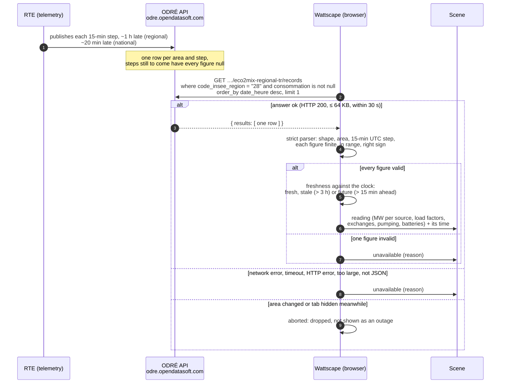
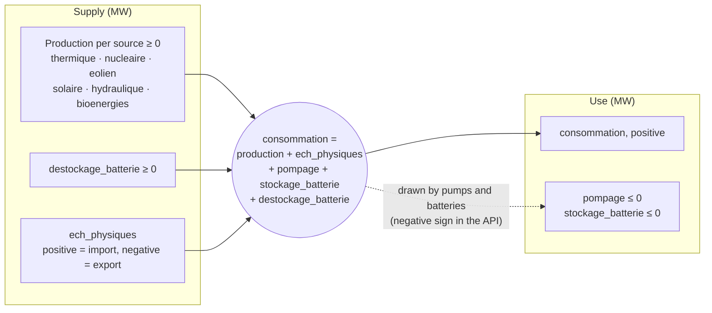

# Architecture

How Wattscape is built. What it does and why is in [`PRD.md`](PRD.md); how we work is
in [`../AGENTS.md`](../AGENTS.md). Statements marked **provisional** are design
choices not yet proven by code or measurement; **unverified** marks facts about an
external system that we have not yet checked against the system itself.

## Stack

- **TypeScript** (strict) compiled and bundled by **Vite**; tests with **Vitest**,
  browser tests with **Playwright**; **ESLint** + **Prettier**. Same versions and
  configuration as Return of the Runners, to share habits.
  - TypeScript is held below 6.1: typescript-eslint 8.x supports TypeScript < 6.1.
    Dependabot ignores newer TypeScript until typescript-eslint supports it.
  - `@types/node` stays on the major version of the Node we run (22, `.nvmrc`).
- **No runtime dependency.** The scene is drawn by our own code into an RGBA pixel
  buffer (see § Rendering), so it renders identically in Node (tests) and in the
  browser.
- **Static site** on GitHub Pages. The browser talks to two keyless public APIs
  (§ Data sources) and nothing else.

## Module layout

Provisional; each folder lands with the backlog item that needs it.

| Path          | Role                                                                                       | Touches the DOM, clock or network? |
| ------------- | ------------------------------------------------------------------------------------------ | ---------------------------------- |
| `src/main.ts` | Boot: wires the clock, data, camera, renderer and UI                                       | yes                                |
| `src/clock/`  | The only reader of wall-clock time; time-lapse and fixed time (`?at=`) for demos and tests | clock                              |
| `src/geo/`    | Regions, offline position → area lookup, map projection                                    | no                                 |
| `src/data/`   | éCO2mix and Open-Meteo clients: URL building, strict parsers, refresh and staleness        | network (fetchers only)            |
| `src/sky/`    | Sun and moon position, moon phase, light keyframes                                         | no                                 |
| `src/map/`    | The baked map of France (land, sea, regions, relief) and its tiles                         | no                                 |
| `src/world/`  | Seeded PRNG; placement of plants, towns, trees and landmarks; level of detail              | no                                 |
| `src/render/` | Palette, dithering, sprites drawn in code, layers, camera, `Surface` (pixel buffer)        | no (the canvas blit is in `ui/`)   |
| `src/i18n/`   | FR and EN catalogs (`fr.json`, `en.json`), language detection                              | no                                 |
| `src/ui/`     | Canvas blit and scaling, input (zoom, pan, keys), legend, captions, settings               | DOM                                |
| `tools/`      | Scripts run by hand: fixture recording, map baking, mockups, screenshots                   | files                              |
| `tests/`      | Unit tests, recorded API fixtures, frame-hash snapshots                                    | —                                  |

Everything outside `clock/`, `data/` fetchers and `ui/` is pure: same inputs, same
output. That is what makes frames reproducible (§ World generation).

## Data sources

Which sources we use, and under which licence, is decided in the register
[`DATA-SOURCES.md`](DATA-SOURCES.md) (GO / NO-GO with a comment for each); only
**GO** sources appear here.

| Source                   | Endpoint                                                                              | Used for                                           | Refresh |
| ------------------------ | ------------------------------------------------------------------------------------- | -------------------------------------------------- | ------- |
| éCO2mix regional (DS-01) | `odre.opendatasoft.com/api/explore/v2.1/catalog/datasets/eco2mix-regional-tr/records` | regional mix, consumption, exchanges, load factors | 15 min  |
| éCO2mix national (DS-02) | same API, dataset `eco2mix-national-tr`                                               | national view                                      | 15 min  |
| Open-Meteo (DS-03)       | `api.open-meteo.com/v1/forecast?current=…`                                            | current weather                                    | 15 min  |

The CSP's `connect-src` lists exactly `https://odre.opendatasoft.com` and
`https://api.open-meteo.com`.

> 💡 **éCO2mix** is RTE's public view of the French grid: RTE runs the high-voltage
> network and publishes, every 15 minutes, how much each technology produces and how
> much is consumed, nationally and per region. **ODRÉ** (Open Data Réseaux Énergies)
> is the open-data portal that serves it through an API.

### éCO2mix: how a reading reaches the scene

Every 15 minutes, while the tab is visible, the browser asks ODRÉ for the latest
published step of the area (`src/data/eco2mix.ts`). Nothing else sits in between:
no backend, no key, no cookie.

What one step says: the area's consumption is met by its own production, plus
what it imports, minus what its pumps and batteries draw. The sign of each field
is the one the API sends; the balance closes to a few MW (§ caveats below).

### éCO2mix: fields and caveats

Checked against the API itself on 2026-11-11: the datasets' field list and
descriptions (S-003, S-009), recorded answers committed in
`tests/fixtures/eco2mix/` (`tools/record-eco2mix.ts`), and every published step of
both datasets from 2026-09-01 to 2026-11-11 run through the parser
(`tools/check-eco2mix.ts`; the ~60 MB export it reads is not committed). The client is
`src/data/eco2mix.ts`; it asks for the latest row with a non-null `consommation`.

| API field (type as sent)                                                | Meaning                                                                   |
| ----------------------------------------------------------------------- | ------------------------------------------------------------------------- |
| `date_heure` (text, `2026-11-11T07:45:00+00:00`)                        | Start of the 15-minute step, UTC                                          |
| `code_insee_region` (text) / `perimetre` (`"France"`)                   | The area of the row                                                       |
| `consommation` (number)                                                 | Consumption, MW                                                           |
| `thermique` (number, regional only)                                     | Fossil thermal, MW; nationally the scene sums `gaz` + `fioul` + `charbon` |
| `nucleaire`, `eolien`, `solaire`, `hydraulique`, `bioenergies` (number) | Production, MW                                                            |
| `ech_physiques` (number)                                                | Net physical exchanges, MW: **positive = import, negative = export**      |
| `pompage` (text regionally, number nationally)                          | Pumped-storage pumps, MW, **≤ 0**                                         |
| `stockage_batterie` / `destockage_batterie` (text regionally)           | Battery charge (≤ 0) and discharge (≥ 0), MW                              |
| `tch_*` (number or `null`, regional only)                               | **Load factor** per technology, %                                         |
| `tco_*` (number, regional only)                                         | Coverage rate (production / consumption, %); not used, it reaches 598 %   |

Caveats (provenance in brackets):

- **Sign of `ech_physiques`:** "exportateur si négatif, importateur si positif"
  (field description, S-003, S-009). The balance confirms it: consumption =
  production + `ech_physiques` + `pompage` + `stockage_batterie` +
  `destockage_batterie`, to a mean of 4 MW or less and a maximum of 21 MW in every
  region over 82 224 steps; with the opposite sign the error would be twice the
  exchange. Nationally the same balance holds to 10 MW on average, but 58 of 6 855
  steps are off by more than 100 MW (up to 3.2 GW, around midday on sunny days of
  September): unexplained, and not a sign issue (tools/check-eco2mix.ts,
  2026-11-11).
- **Numbers sent as text:** `pompage` and the battery columns regionally,
  `hydraulique_fil_eau_eclusee` nationally, are JSON strings such as `"-50"` (field
  types in S-003, S-009, and the fixtures). The parser accepts a plain integer or
  decimal string there.
- **Missing values:** the spec's "ND", "-" and "DC" markers (S-007) never appear in
  the API over the 10 weeks checked: every published step has every figure. A step
  not yet published has every figure `null` (recorded fixture
  `…-regional-empty-step`). A technology absent from a region is sent as **0 MW
  with a `null` load factor**: `nucleaire = 0` and `tch_nucleaire = null` in every
  step of Île-de-France, Bourgogne-Franche-Comté, Pays de la Loire, Bretagne and
  Provence-Alpes-Côte d'Azur. The scene therefore tells "no such plant" (load
  factor `null`) from "plant idle" (load factor 0). Any other `null`, string or
  out-of-range value makes the whole reading "unavailable", never 0.
- **Load factor above 100 %:** `tch_hydraulique` reaches 125 % and
  `tch_bioenergies` 114 % (2026-09-01 to 2026-11-11), presumably because the
  capacity reference lags new installations (not confirmed). The parser accepts
  0–200 %; the scene clamps (B-012).
- **No load factors nationally:** the national dataset has no `tch_*` column
  (S-009), so the national view needs installed capacities to animate plants
  (DS-07, B-012).
- **Delay:** at 08:48 UTC on 2026-11-11 the latest regional step was 07:45 UTC
  (63 min old) and the latest national one 08:30 UTC (18 min). The datasets keep
  about 10 weeks: from 2026-08-31 22:00 UTC that day (S-003, S-009). A reading is
  labelled stale after 3 hours (`STALE_AFTER_MS`, provisional); a step more than
  15 minutes ahead of the clock counts as unavailable. A request is given up after
  30 s, and an answer over 64 KB is rejected.
- **Revisions:** a published step can still change: Île-de-France at 07:45 UTC read
  7 757 MW at 08:48 and 7 758 MW at 08:54 (2026-11-11). Month M is replaced by
  consolidated data mid-M+1 (S-004). A recorded fixture is dated, never refreshed.
- The onshore/offshore wind split is national only (S-009). The battery columns,
  "not available" regionally in the file specification (S-007), are filled in the
  regional API (S-003).
- Corsica is not in the regional dataset (12 regions, S-003): Corsica gets the
  national view.
- **CORS:** answers carry `Access-Control-Allow-Origin: *`, so the browser can call
  the API directly (2026-11-11).
- **Rate limits:** answers carry `X-RateLimit-Dataset-Limit: 50000` per month and
  `X-RateLimit-Limit: 10000000` per day (2026-11-11, S-004). One viewer refreshing
  every 15 minutes makes about 3 000 calls a month; never poll faster, and stop when
  hidden.
- **Flaky connection from the cloud sessions:** about one connection in three to
  ODRÉ was reset through the session proxy on 2026-11-11; the recording tools
  retry. Whether browsers see this is unknown.

### Open-Meteo

Checked against the API itself on 2026-11-11: answers recorded at three landmarks in
`tests/fixtures/open-meteo/` (`tools/record-open-meteo.ts`), and the API's own list
of weather codes (S-010). The client is `src/data/open-meteo.ts`.

- **Query:** `current=temperature_2m,weather_code,cloud_cover,precipitation,snowfall,snow_depth,wind_speed_10m,wind_direction_10m,is_day`
  and `timeformat=unixtime`, at the position rounded to 0.1° (`roundPosition`; the
  URL prints exactly one decimal).
- **Answer:** `latitude`/`longitude` of the model's grid point, not the position
  asked (49.4, 1.1 → 49.4017, 1.0999; the Mont Blanc summit → a point at 2 308 m);
  `current_units`; `current` with `time` (seconds, UTC, start of a 15-minute
  interval: `interval` = 900) and one number per field. The parser checks each unit
  (°C, %, mm, cm, m, km/h, °, wmo code), so a change of unit cannot pass as a value,
  and rejects a grid point more than 0.5° away from the position asked.
- **Units and meaning** (S-010): `precipitation` (mm) and `snowfall` (cm) are sums
  over the preceding hour for hourly data; over which window for `current` (15
  minutes or an hour) is **unverified**, so no formula may rely on it yet;
  `snow_depth` is snow on the ground in **metres**;
  `cloud_cover` is total cover in %; `wind_direction_10m` is where the wind blows
  from; `is_day` is 1 in daylight at the grid point.
- **Errors:** `{"error": true, "reason": "…"}` with HTTP 400 for a bad query, 429
  when the daily quota is spent (recorded). The quota is per address: 10 000 calls a
  day (`X-RateLimit-Limit`, `X-RateLimit-Window: 86400`). The cloud sessions share
  their address and often get 429; a viewer's browser has its own.
- **CORS:** `Access-Control-Allow-Origin: *` (2026-11-11).
- **Freshness:** a reading is labelled stale after 1 hour (four missed refreshes,
  `WEATHER_STALE_AFTER_MS`, provisional); one more than 15 minutes ahead of the
  clock counts as unavailable. Requests share the éCO2mix client's rules
  (`src/data/fetch-json.ts`): 30 s timeout, size cap, abort.
- **Weather codes:** the API sends a subset of WMO code table 4677 (S-010). One
  invalid field, or a code outside this table, makes the whole reading
  "unavailable" (D-010).

| WMO codes (S-010)                              | Group     |
| ---------------------------------------------- | --------- |
| 0 clear sky, 1 mainly clear                    | `clear`   |
| 2 partly cloudy, 3 overcast                    | `cloudy`  |
| 45 fog, 48 depositing rime fog                 | `fog`     |
| 51, 53, 55 drizzle; 56, 57 freezing drizzle    | `drizzle` |
| 61, 63, 65 rain; 66, 67 freezing rain          | `rain`    |
| 80, 81, 82 rain showers                        | `rain`    |
| 71, 73, 75 snowfall; 77 snow grains            | `snow`    |
| 85, 86 snow showers                            | `snow`    |
| 95, 97 thunderstorm; 96, 99 thunderstorm, hail | `storm`   |

## Privacy

- The browser's Geolocation API is called only when the user presses "Use my
  location" (no prompt on load).
- The position is used for: (1) the offline area lookup (§ Geolocation); (2) the
  weather query, **rounded to 0.1°** (about 10 km). It is never stored, logged,
  put in the URL or sent elsewhere. What is remembered in `localStorage` is the area
  code only.
- Without a position, the weather will be taken (B-007) at the area's reference
  point, its regional prefecture (`referencePoint`); the national view has none
  (provisional).
- The position is rounded to 0.1° as soon as it arrives (`src/ui/area-picker.ts`);
  the raw value is never kept.

### Geolocation

`src/geo/regions.ts` maps a position to the region of the **nearest prefecture**
(94 mainland prefectures + 2 in Corsica, coordinates from S-006), with distances on
an equirectangular projection at the position's latitude. The cosine is a Taylor
series (`cosDeg`), not `Math.cos`, so every engine picks the same area. This is **provisional**,
until the baked map (B-008) lets the lookup read the region of the map cell.

Measured with `tools/check-regions.ts` against the official outlines (S-011,
2026-11-11):

- every prefecture lies inside its own département and region;
- **8.0 % of the mainland's area** maps to a neighbouring region (1 604 of 20 000
  random points), mostly in large regions far from their prefectures. A famous case:
  Mont-Saint-Michel (Normandie) is nearer Rennes than Saint-Lô, so it maps to
  Bretagne. The viewer can always correct it from the region list;
- every point of the mainland is within 112 km of a prefecture, so a position
  farther than **120 km** from every prefecture is abroad (`ABROAD_KM`) and gets
  the national view. Towns just across a border (Geneva, Brussels, Basel,
  Luxembourg, Monaco, Andorra, Jersey) still map to the French region next door.

Corsica gets the national view (no regional data, S-003); near Corsica but outside
its bounding box (Sardinia) is abroad. The UI (`src/ui/area-picker.ts`)
offers the region list and a "Use my location" button; the URL setting `?area=`
(`src/ui/settings.ts`) wins over the remembered area, which wins over France. On
refusal, without the Geolocation API, or with no answer within 60 s (the prompt
may never call back), the viewer stays on the area they are on. Abroad or in
Corsica the view switches to France for the visit without overwriting the
remembered region. An answer that arrives after the viewer picked an area by hand
is dropped; the button can always be pressed again. Region
names are the official French names in every language (D-011).

## Map

**Provisional**, settled by B-008 once the art direction is chosen.

- The map is **baked at build time** by `tools/bake-map` from open geographic data
  into a small committed file: a grid of cells (about 4 km) with, per cell, land/sea,
  region code and an elevation class. Candidate sources: DS-04 (regions) and DS-05
  (relief) in `DATA-SOURCES.md`; the baked file gets an ASSETS entry.
- Projection: longitude scaled by cos 46.5° (an equirectangular projection centred on
  France), then the isometric 2:1 transform of § Art direction. Good enough at this
  scale; a Lambert-93 projection can replace it without touching the renderer.
- Real places (plants, landmarks, towns) are stored as latitude/longitude and
  projected the same way.

## World generation

- `src/world/prng.ts`: a small seeded PRNG (e.g. mulberry32), seeded per map cell
  from (global seed, cell x, cell y), so any part of the world can be generated alone
  and always identically.
- Placement decides **what** is where (trees, houses, wind turbines, solar fields)
  with integer and rational arithmetic only; transcendental functions are allowed
  for **how** things move (a turbine's angle), never for placement.
- Diffuse sources are placed with a density per region proportional to its installed
  capacity per technology (candidate source: DS-07, aggregated by region and baked at
  build time; **provisional**).

## Data-to-scene mapping

The acceptance criterion for the scene (AGENTS.md § Faithfulness). Every row names
its figure and its formula. **Provisional** until B-012: the formulas will be tuned on
real recorded data, then fixed here.

| On screen                           | Figure                         | Formula (provisional)                                                |
| ----------------------------------- | ------------------------------ | -------------------------------------------------------------------- |
| Steam plumes of cooling towers      | `tch_nucleaire`                | plume height and puff rate ∝ load factor; no plume at 0              |
| Seaside nuclear plants (no towers)  | `tch_nucleaire`                | warm-water shimmer and lit buildings ∝ load factor                   |
| Wind turbine rotors                 | `tch_eolien`                   | rotation speed ∝ load factor; stopped at 0                           |
| Solar fields                        | `tch_solaire`                  | glint density ∝ load factor (so 0 at night, low under clouds)        |
| Dams and weirs                      | `tch_hydraulique`              | spillway flow ∝ load factor                                          |
| Thermal plant chimneys              | `tch_thermique`                | smoke rate ∝ load factor                                             |
| Bioenergy plants                    | `tch_bioenergies`              | small smoke and a lit furnace ∝ load factor                          |
| Town windows lit, power-line pulses | `consommation`                 | ∝ position of consumption in the area's typical range (baked p5–p95) |
| Legend: stacked bar and figures     | MW per source, `ech_physiques` | shares of total production; import if > 0, export if < 0             |

A missing figure shows the element **idle** (no motion, no glow) and the caption says
"no data", never a guessed value.

## Sky, light and weather

- **Sun:** NOAA's solar position algorithm (S-008) gives elevation and azimuth for
  the place and instant; tested against the NOAA calculator for several cities and
  dates.
- **Moon:** phase from the synodic month (29.53 days) since a reference new moon,
  accurate to about a day, which is enough to draw it; position from a simplified
  ephemeris (provisional).
- **Light keyframes** by solar elevation: night (< −12°), blue hour (−12° to −4°),
  golden hour (−4° to 6°), day (> 6°). Each keyframe sets a sky gradient, a global
  tint for the land, and whether emissive pixels show. Keyframes interpolate in
  palette steps, not RGB, to stay in palette (§ Art direction).
- **Weather layers:** clouds (count and darkness from `cloud_cover`, drifting with
  the wind), rain and snow particles, fog banks (dithered), lightning flashes for
  storms. Particles are seeded (PRNG) so frames stay reproducible.
- **Seasons (provisional, D-008):** a season position from the day of the year (an
  angle over the year, so that transitions are continuous), mapped to four keyframes
  centred on mid-January, mid-April, mid-July and mid-October. Each keyframe is a
  **land palette ramp** (grass, leaves, fields, soil) and a set of seasonal props
  (blossom, ripe crops, fallen leaves, bare branches); between two keyframes, cells
  switch from one to the next by a seeded per-cell threshold, so the change spreads
  across the map like a real season instead of a global fade. Snow cover comes from
  Open-Meteo's `snow_depth` (metres, checked in B-006), with altitude: the
  Alps whiten before the plains.

## Art direction

Direction A, the isometric map, was chosen by Guillaume on 2026-11-11 (PRD Q-1). The
details below (palette, resolution, level of detail) are still **proposed** until the
mockups of B-010 are validated.

- **Projection:** isometric 2:1 (a tile is twice as wide as it is
  tall), light from the south-east, no perspective.
- **Resolution:** the scene is drawn at low resolution into a pixel buffer, then
  scaled by an **integer** factor to the screen (nearest-neighbour); the buffer size
  follows the window so that the factor is 3 to 6 on common screens.
- **Zoom and level of detail (provisional):** the camera zoom is continuous, but each
  frame is drawn at the nearest of a few levels of detail (France, region, close),
  each with its own sprite set; between two levels, a short crossfade. Integer
  scaling keeps pixels crisp; a spike in B-011 checks that this feels smooth enough.
- **Palette:** about 24 colours, fixed: muted land (greens, ochres, greys), deep
  sea blues, a sky ramp, and **one signature colour per source**, also used in the
  legend:

  | Source    | Signature colour (proposed) | Why                           |
  | --------- | --------------------------- | ----------------------------- |
  | Nuclear   | warm yellow                 | the usual colour in grid maps |
  | Hydro     | blue                        | water                         |
  | Wind      | light teal                  | air                           |
  | Solar     | orange                      | sun                           |
  | Thermal   | brown-grey                  | smoke, fossil                 |
  | Bioenergy | green                       | biomass                       |

- **Shapes:** flat colours, a 1-pixel darker edge instead of black outlines, no
  anti-aliasing; gradients (sky, fog, water depth) only by 4×4 ordered (Bayer)
  dithering between two palette colours.
- **Night:** the scene is drawn with the day palette, darkened by the light tint,
  then emissive pixels (windows, beacons, illuminated landmarks, lit plumes) are
  drawn on top, untinted.
- **Sprites** are drawn in code (`src/render/art/`), from simple primitives (spans,
  rectangles, polygons) and seeded noise; no image files (ASSETS.md).
- **Motion:** slow and sparse; nothing blinks faster than about 2 Hz; with
  `prefers-reduced-motion`, no camera drift and half-speed animation.

### Landmarks

Which landmarks are drawn, and why, is decided in the register
[`POI.md`](POI.md) (GO / NO-GO with a comment for each, D-004). Only **GO** landmarks
are drawn; each is drawn in code from public views of the site, never traced from a
photo.

## Rendering and loop

- The renderer draws into a `Surface` (an RGBA `Uint8ClampedArray` with width and
  height). In the browser, `ui/` blits it with `putImageData` into a canvas scaled
  by CSS with `image-rendering: pixelated`; in tests, the same buffer is hashed.
- Static layers (terrain, buildings) are cached per map chunk and level of detail;
  only animated elements (plumes, rotors, water, weather, lights) are redrawn each
  frame.
- `requestAnimationFrame`, capped at 30 fps (PRD Q-7); paused when the tab is hidden
  (Page Visibility API), which also pauses data refreshes.

## Performance

Budget (**provisional**, to be measured in B-013 and fixed here):

- ≤ 8 ms of main-thread work per frame on a mid-range laptop at 1080p;
- memory flat over a 4-hour run (no growing caches: every cache has a cap);
- no network beyond 2 requests every 15 minutes.

## Internationalization

- `src/i18n/`: one JSON catalog per language (FR, EN) with the same keys, checked by
  a test and by the type checker (`satisfies`); French is the default and the
  fallback; the choice is remembered in `localStorage`; numbers and times formatted with `Intl` in the active language.
- Region and landmark names are proper nouns kept in French in both languages.

## Security

- **Untrusted input:** API responses and URL settings. Parsers live in `src/data/`
  and `src/ui/settings.ts`; they accept only the documented shape, finite numbers in
  range (|MW| ≤ 200 000, load factors 0–200 %), bounded strings, known area codes; they
  never throw past the boundary: a bad response is "data unavailable".
- No `innerHTML`, `eval` or `new Function` anywhere (lint rules); captions use
  `textContent`.
- **CSP** (in `index.html`):
  `default-src 'self'; script-src 'self'; style-src 'self'; img-src 'self' data:; connect-src https://odre.opendatasoft.com https://api.open-meteo.com; object-src 'none'; base-uri 'self'; form-action 'none'`.
  The dev server alone adds `'self' ws:` to `connect-src` for live reload
  (`vite.config.ts`); the build ships the CSP unchanged.

## Build, CI and deploy

- `npm run build` → `dist/`, served from `/wattscape/` on GitHub Pages
  (`https://guillaumedd.github.io/wattscape/`).
- CI (`.github/workflows/ci.yml`) on every PR and push to `main`: `npm ci`,
  typecheck, lint, test, build, `npm audit --omit=dev`, gitleaks over the full
  history. Deploy (`deploy.yml`) on push to `main`. Actions pinned by SHA.

## Browser quirks

All **unverified** until measured in Chromium, Firefox and WebKit (AGENTS.md §5):

- Geolocation needs a secure context (GitHub Pages is HTTPS; `localhost` counts).
  Browsers may remember a refusal, so the app must offer the region list without
  asking again.
- The Screen Wake Lock API is missing in some browsers and is released when the tab
  is hidden: request it again on `visibilitychange`.
- The Fullscreen API is limited on iPhone Safari; the scene must work without it.
